# Manufacturing Process Lab Portal

> A Django web app for the foundry and welding experiments in the B.Tech Manufacturing Processes lab. Students enter their readings and get the full step-by-step calculation, an auto-plotted graph, and the results emailed to them as a formatted report.

[](#)
[](#)
[](#)
[](#)
[](https://mpvirtuallab.pythonanywhere.com/)

**🔗 Live:** https://mpvirtuallab.pythonanywhere.com/ (independently deployed on PythonAnywhere)

---

## Problem

Lab-record calculations (Grain Fineness Number, moisture %, clay %, compressive and shear strength, weld and pattern dimensions) are usually done by hand, with graphs drawn on paper. That makes arithmetic slips easy and gives students no quick way to check their results before submitting.

## Features

- **Experiment catalogue** with aim, apparatus, procedure and formulae for each experiment:
  - Foundry sand tests: **Sieve analysis (GFN)**, **Moisture content**, **Clay content**, **Green compression & shear strength**
  - Pattern making: **Solid flange**, **Stepped cone**, **Hollow pipe**
  - Welding joints: **Single-V butt**, **Corner joint**, **Double parallel fillet**
- **Step-by-step solutions**: every intermediate value is shown, not just the final answer.
- **Auto-generated graphs** with Matplotlib (e.g. the cumulative % retained curve for sieve analysis).
- **Emailed results**: an HTML report with the readings table, calculation explanation and graph inline (`EmailMultiAlternatives` + `MIMEImage`).
- One data-driven view (`run_experiment(slug)`) serves every experiment, with a dedicated template per experiment.

## Architecture

```mermaid
flowchart LR
    S[Student] -->|readings + email| V[run_experiment&#40;slug&#41;]
    V --> C[Calculation engine<br/>NumPy]
    C --> G[Matplotlib graph<br/>PNG in memory]
    C --> R[Result page<br/>step-by-step]
    G --> R
    C --> E[HTML email via SMTP<br/>inline graph]
```



## Tech stack

Django 5 · NumPy · Matplotlib · WhiteNoise · Gunicorn

## Project structure

```
├── labapp/                         # settings, urls, wsgi
├── experiments/
│   ├── views.py                    # experiment registry + calculation logic + email
│   ├── templates/experiments/      # one template per experiment
│   └── templatetags/custom_filters.py
├── Procfile                        # gunicorn labapp.wsgi
└── requirements.txt
```

## Getting started

```bash
git clone https://github.com/karrisubhash/Manufacturing-Process-Lab.git
cd Manufacturing-Process-Lab
python -m venv .venv && source .venv/bin/activate
pip install -r requirements.txt
python manage.py migrate
python manage.py runserver
```

### Environment variables

All configuration comes from the environment; nothing secret is stored in the repository.

| Variable | Purpose |
|---|---|
| `DJANGO_SECRET_KEY` | Django secret key (a random one is generated if unset, which resets sessions on restart) |
| `DJANGO_DEBUG` | `True` for local development; defaults to `False` |
| `DJANGO_ALLOWED_HOSTS` | Comma-separated; defaults to `localhost,127.0.0.1,mpvirtuallab.pythonanywhere.com` |
| `EMAIL_HOST_USER` | Gmail address used to send results |
| `EMAIL_HOST_PASSWORD` | Gmail **app password** |

```bash
export DJANGO_DEBUG=True EMAIL_HOST_USER=you@gmail.com EMAIL_HOST_PASSWORD=<app-password>
```

On PythonAnywhere, set them at the top of the WSGI file (`os.environ[...] = ...`) and reload the web app.

## Routes

| Path | Purpose |
|---|---|
| `/` | Experiment list |
| `/<slug>/` | Run an experiment, e.g. `sieve-analysis`, `moisture-content`, `clay-content`, `green-compression` |

## Screenshots

<!-- TODO(Subhash): add the experiment list, a result page with its graph, and the email -->

## Testing

```bash
python manage.py test experiments
```

No tests exist yet. The highest-value next step is unit tests for each calculation function.

## Future improvements

- Move the calculation logic out of `views.py` into a pure `calculations.py` module and unit-test every formula.
- Add a PDF lab-record download.
- Add a teacher dashboard for submitted readings.
